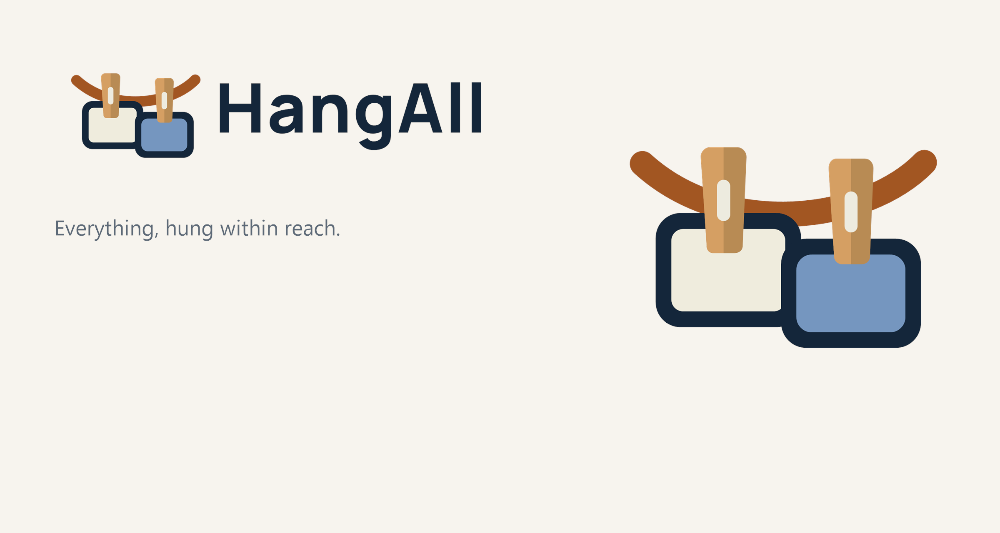
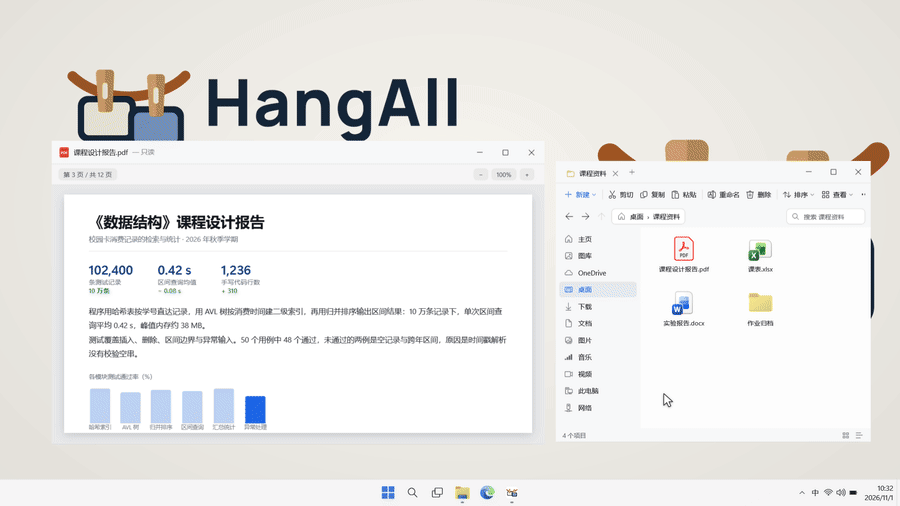

<p align="center">
  
</p>

<h1 align="center">HangAll</h1>

<p align="center">
  Keep screenshots, files and notes on a line at the top of your screen.
  <br>
  Windows 10 / 11 · x64 · English, Simplified Chinese, Traditional Chinese, Japanese, Korean
</p>

<p align="center">
  <a href="https://github.com/WatsonLearnCode/HangAll">GitHub</a>
  ·
  <a href="README.md">简体中文</a>
  ·
  <a href="https://github.com/WatsonLearnCode/HangAll/issues">Issues</a>
  ·
  <a href="https://github.com/WatsonLearnCode/HangAll/releases">Download</a>
</p>

<picture>
  <source media="(prefers-color-scheme: dark)" srcset="docs/hero-dark.png">
  
</picture>

## Download and install

Download the latest `v1.0.0` release from [GitHub Releases](https://github.com/WatsonLearnCode/HangAll/releases). The release contains:

| File | Purpose | .NET 8 Desktop Runtime |
|:--|:--|:--|
| `HangAll-1.0.0-Setup.exe` | Installer for install, upgrade and uninstall flows | Required |
| `HangAll-1.0.0-win-x64.exe` | Framework-dependent single-file build | Required |
| `HangAll-1.0.0-win-x64-portable.exe` | Self-contained portable build | Not required |
| `SHA256SUMS.txt` | SHA256 checksums for all release binaries | N/A |

The installer defaults to `%LOCALAPPDATA%\Programs\HangAll` and does not require administrator access. Its license page supports English, Simplified Chinese, Traditional Chinese, Japanese and Korean.

### Unsigned builds

The current release binaries are not code-signed. Windows SmartScreen may show a warning. Verify the downloaded file against `SHA256SUMS.txt` before running it:

```powershell
Get-FileHash .\HangAll-1.0.0-Setup.exe -Algorithm SHA256
Get-Content .\SHA256SUMS.txt
```

The two values must match. If they do not, remove the file and download it again from the Releases page.

## Features



- Rest the pointer against the top edge to bring the line down; it hides again when the pointer leaves.
- Add files by dragging, copying or using the watched screenshot folders.
- Click a card to copy it, double-click to open it, or drag cards to reorder them.
- Drop cards into another app or folder, or remove them from the line without moving the original.
- Right-click for copy, text recognition, open, edit, reveal, pin, save and remove actions.
- Image markup includes undo, redo and restore. Notes, multiple monitors, DPI scaling and light or dark themes are supported.
- `Ctrl+Alt+T` toggles the line.

HangAll needs no account and has no telemetry. The one feature that goes online is the update check: it reads the public GitHub Releases API, uploads nothing, and can be switched off or left manual in the settings. Settings, logs, captures, originals and line data live in `%LOCALAPPDATA%\HangAll` and never leave the machine.

## OCR language packs

Text recognition uses Windows OCR and does not upload images. If recognition is unavailable, or the command-line test returns `<ocr unavailable>`, the Windows OCR language feature is probably incomplete.

Try these steps:

1. Open **Settings > Time & language > Language & region**, select the language, and check that its OCR or optional language feature is installed.
2. If Windows just installed a language pack or update, save your work and restart Windows so pending servicing transactions can complete.
3. Check that `C:\Windows\OCR` exists.
4. Run the built-in regression command:

```powershell
& "$env:LOCALAPPDATA\Programs\HangAll\HangAll.exe" --ocr .\test.png .\ocr-result.txt
```

The exit code should be `0`, and the output file should contain real text instead of `<ocr unavailable>`.

If recognition is still unavailable, an administrator can add the OCR capabilities and restart Windows:

```powershell
Add-WindowsCapability -Online -Name Language.OCR~~~zh-CN
Add-WindowsCapability -Online -Name Language.OCR~~~en-US
```

## Build

Requirements:

- Windows 10 version 1809 or later, or Windows 11, x64
- .NET 8 SDK
- Inno Setup 6 or 7 when building the installer (CI uses 7.1.0)

From the repository root:

```powershell
scripts\build.ps1 -Version 1.0.0
scripts\build.ps1 -Version 1.0.0 -Installer
scripts\build.ps1 -Portable -Version 1.0.0
```

Outputs:

- `dist\win-x64\HangAll.exe`: framework-dependent single-file build
- `dist\portable\HangAll.exe`: self-contained portable build
- `dist\HangAll-1.0.0-Setup.exe`: installer

The release workflow is in [`.github/workflows/release.yml`](.github/workflows/release.yml). A `v*` tag builds every release file, fails if a required file is missing, and generates `SHA256SUMS.txt`.

## Attribution and license

HangAll is an independent project. Portions of its implementation and design are derived from these MIT projects:

- [Snapline](https://github.com/mohabujubara/snapline): Copyright (c) 2026 Snapline contributors
- [Tendedero](https://github.com/alejandrobujan/tendedero): Copyright (c) 2026 Alejandro Buján (the Snapline notice states 2025). Tendedero's license grants no rights to its name or icon and asks modified or redistributed versions to use a different name and icon; HangAll uses its own name, wordmark and icon, all generated by `scripts/make-brand.ps1` from one brand geometry, with no Tendedero artwork.

The interface branding uses [Manrope](https://github.com/google/fonts/tree/main/ofl/manrope), licensed separately under the SIL Open Font License 1.1. See [`src/HangAll/Assets/Fonts/OFL.txt`](src/HangAll/Assets/Fonts/OFL.txt).

Interface icons are built on [Morphicons](https://github.com/guillermolg00/morphicons) (MIT) and [Lucide Static](https://github.com/lucide-icons/lucide) (ISC).

Some visual details were inspired by [Uiverse Galaxy](https://github.com/uiverse-io/galaxy) (MIT, Copyright (c) 2023 Uiverse.io), but none of its code, stylesheets or artwork is used; the effects are implemented independently in WPF.

See [`THIRD-PARTY-NOTICES.txt`](THIRD-PARTY-NOTICES.txt) for the complete notices and [`licenses/third-party/`](licenses/third-party/) for the full license texts. These projects do not imply endorsement of HangAll. The simulated desktop in the documentation film uses icons captured from the local Windows installation; Windows, Microsoft Edge, OneDrive and the Windows logo are trademarks of Microsoft Corporation and appear there only to illustrate the environment. HangAll is not affiliated with Microsoft, and the application and its assets contain no Microsoft icon files — system icons are read from the machine at run time.

HangAll is released under the MIT License. The English text in the repository root [LICENSE](LICENSE) is authoritative; the files under `licenses/` are reference translations. The Traditional Chinese reference is region-neutral and uses the `zh-Hant` language tag.

## Contributing

Before opening an issue, read [CONTRIBUTING.md](CONTRIBUTING.md) and [SECURITY.md](SECURITY.md). Use [GitHub Issues](https://github.com/WatsonLearnCode/HangAll/issues) for bugs and feature requests. Do not disclose security vulnerabilities publicly.
