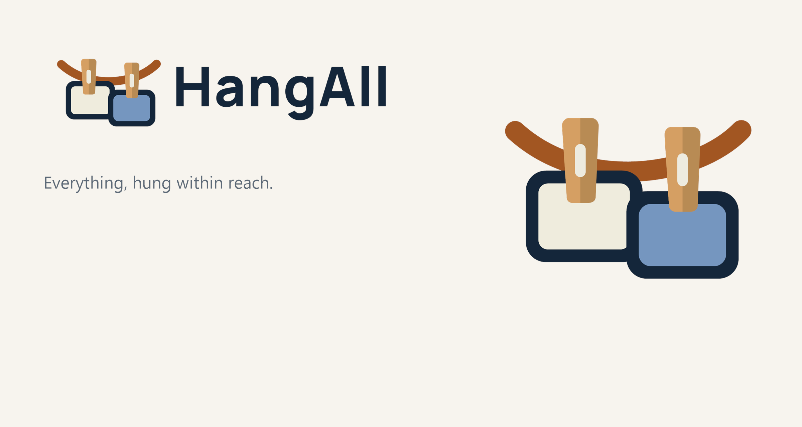
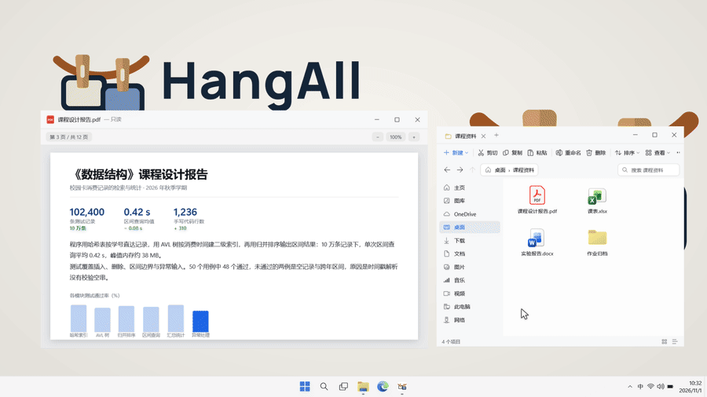

<p align="center">
  
</p>

<h1 align="center">HangAll 挂万物</h1>

<p align="center">
  把截图、文件和便签挂在屏幕顶部，需要时滑下来取用。
  <br>
  Windows 10 / 11 · x64 · 简体中文、繁體中文、English、日本語、한국어
</p>

<p align="center">
  <a href="https://github.com/WatsonLearnCode/HangAll">GitHub</a>
  ·
  <a href="README.en.md">English</a>
  ·
  <a href="https://github.com/WatsonLearnCode/HangAll/issues">问题反馈</a>
  ·
  <a href="https://github.com/WatsonLearnCode/HangAll/releases">下载</a>
</p>

<picture>
  <source media="(prefers-color-scheme: dark)" srcset="docs/hero-dark.png">
  
</picture>

## 下载与安装

请从 [GitHub Releases](https://github.com/WatsonLearnCode/HangAll/releases) 下载 `v1.0.0` 或更新版本。每个版本包含以下文件：

| 文件 | 用途 | 是否需要 .NET 8 Desktop Runtime |
|:--|:--|:--|
| `HangAll-1.0.0-Setup.exe` | 安装版，推荐使用；可按向导安装、升级和卸载 | 是 |
| `HangAll-1.0.0-win-x64.exe` | 框架依赖的单文件版，适合已有的 .NET 8 环境 | 是 |
| `HangAll-1.0.0-win-x64-portable.exe` | 自包含便携版，可直接运行 | 否 |
| `SHA256SUMS.txt` | 三个发行文件的 SHA256 校验值 | 不适用 |

安装版默认安装到 `%LOCALAPPDATA%\Programs\HangAll`，不要求管理员权限。当前安装器的许可证页面支持简体中文、繁体中文、英文、日文和韩文，并会随程序安装根许可证、第三方声明和 Manrope 字体许可证。

### 未签名提示

当前 Release 二进制尚未进行代码签名。Windows SmartScreen 可能显示“Windows 已保护你的电脑”等提示。请先使用 `SHA256SUMS.txt` 核对下载文件，再决定是否运行。

在 PowerShell 中可这样校验：

```powershell
Get-FileHash .\HangAll-1.0.0-Setup.exe -Algorithm SHA256
Get-Content .\SHA256SUMS.txt
```

两个结果应完全一致。若不一致，请删除文件并从 Releases 页面重新下载。

## 功能



- 把鼠标停在屏幕上沿时，挂载线会滑下来；鼠标移开后自动收起。
- 支持拖入文件、复制文件或图片、监听系统截图文件夹和捕获剪贴板截图。
- 单击卡片复制，双击用系统默认程序打开，拖动卡片可排序。
- 可把卡片拖到其他程序或资源管理器文件夹，也可拖到回收站取下。
- 右键卡片可复制、复制文字、打开、编辑、定位、固定、保存或移除。
- 支持图片标注、撤销、重做、恢复原图、便签、多显示器、DPI 缩放、浅色和深色主题。
- 支持手动排序、按挂载时间和按文件类型排序。
- `Ctrl+Alt+T` 可展开或收起挂载线。

HangAll 不需要账号，也没有遥测；唯一会联网的是「检查更新」——它只读取 GitHub 的公开 Releases 接口，不会上传任何数据，可在设置里关闭或改为手动检查。设置、日志、截图、原图和挂载数据默认保存在 `%LOCALAPPDATA%\HangAll`，不会离开本机。

## OCR 与语言包

“识别文字”使用 Windows 自带的 OCR，不会把图片上传到网络。如果右键菜单中的文字识别不可用，或命令行返回 `<ocr unavailable>`，通常是 Windows OCR 语言包尚未安装完成。

可按以下顺序排查：

1. 打开 **设置 > 时间和语言 > 语言和区域**，选中需要的显示语言，确认“语言选项”中的 OCR 或可选语言功能已经安装。
2. 若刚刚安装过语言包或 Windows 更新，请保存工作后重启 Windows，让挂起的系统事务完成。
3. 确认 `C:\Windows\OCR` 已生成。
4. 用安装目录中的 `HangAll.exe` 做一次回归测试：

```powershell
& "$env:LOCALAPPDATA\Programs\HangAll\HangAll.exe" --ocr .\test.png .\ocr-result.txt
```

退出码应为 `0`，输出文件应包含真实识别文本，而不是 `<ocr unavailable>`。

如仍不可用，可由管理员重新添加系统 OCR 功能：

```powershell
Add-WindowsCapability -Online -Name Language.OCR~~~zh-CN
Add-WindowsCapability -Online -Name Language.OCR~~~en-US
```

完成后重启 Windows，再重复上面的测试。

## 构建

要求：

- Windows 10 1809 或更高版本，或 Windows 11，x64
- .NET 8 SDK
- 如需生成安装包，安装 Inno Setup 6 或 7（CI 使用 6.7.1）

在仓库根目录执行：

```powershell
scripts\build.ps1 -Version 1.0.0
scripts\build.ps1 -Version 1.0.0 -Installer
scripts\build.ps1 -Portable -Version 1.0.0
```

输出文件：

- `dist\win-x64\HangAll.exe`：框架依赖单文件版
- `dist\portable\HangAll.exe`：自包含便携版
- `dist\HangAll-1.0.0-Setup.exe`：安装包

发布流程位于 [`.github/workflows/release.yml`](.github/workflows/release.yml)。推送 `v*` 标签后，工作流会构建全部文件、检查文件是否存在并生成 `SHA256SUMS.txt`。

## 来源与致谢

HangAll 是独立产品。部分实现和设计思路来自以下 MIT 开源项目：

- [Snapline](https://github.com/mohabujubara/snapline)：Copyright (c) 2026 Snapline contributors
- [Tendedero](https://github.com/alejandrobujan/tendedero)：Copyright (c) 2026 Alejandro Buján（Snapline 的声明写作 2025）。Tendedero 的许可证不包含其名称与图标的使用权，要求修改或再分发版本换用别的名称和图标；HangAll 使用自己的名称、字标和图标，图标全部由 `scripts/make-brand.ps1` 从同一份品牌几何生成，不含 Tendedero 的美术资源。

界面品牌字体使用 [Manrope](https://github.com/google/fonts/tree/main/ofl/manrope)，其独立许可证为 SIL Open Font License 1.1，完整文本见 [`src/HangAll/Assets/Fonts/OFL.txt`](src/HangAll/Assets/Fonts/OFL.txt)。

界面图标基于 [Morphicons](https://github.com/guillermolg00/morphicons)（MIT）与 [Lucide Static](https://github.com/lucide-icons/lucide)（ISC）。

部分视觉细节的灵感来自 [Uiverse Galaxy](https://github.com/uiverse-io/galaxy)（MIT，Copyright (c) 2023 Uiverse.io），但未使用其代码、样式表或素材，相关效果均为本项目用 WPF 独立实现。

完整第三方说明见 [`THIRD-PARTY-NOTICES.txt`](THIRD-PARTY-NOTICES.txt)，各组件的完整许可证文本见 [`licenses/third-party/`](licenses/third-party/)。以上项目与 HangAll 不存在隶属或背书关系。演示图里模拟桌面的图标取自本机安装的 Windows 应用，Windows、Microsoft Edge、OneDrive 与 Windows 徽标是 Microsoft Corporation 的商标，仅用于说明运行环境；HangAll 与 Microsoft 无关，程序本体与素材中不含 Microsoft 的图标文件，系统图标由程序在运行时从本机读取。

## 许可证

HangAll 使用 MIT License 发布。仓库根目录的 [LICENSE](LICENSE) 为英文权威版本；`licenses/` 目录提供简体中文、无地区区分的繁体中文（`zh-Hant`）、日文和韩文参考译文。若译文与英文版有冲突，以英文版为准。

## 参与项目

提交问题前请先阅读 [CONTRIBUTING.md](CONTRIBUTING.md) 和 [SECURITY.md](SECURITY.md)。功能建议和使用问题可通过 [GitHub Issues](https://github.com/WatsonLearnCode/HangAll/issues) 提交；安全漏洞请不要公开披露。
